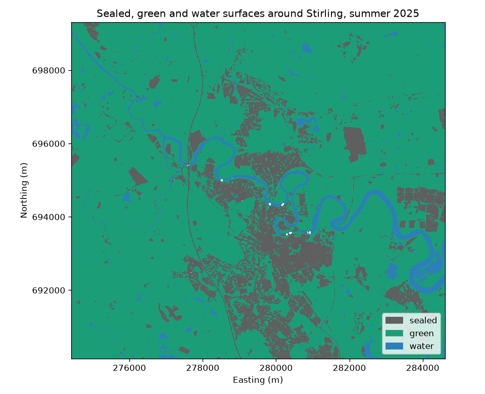
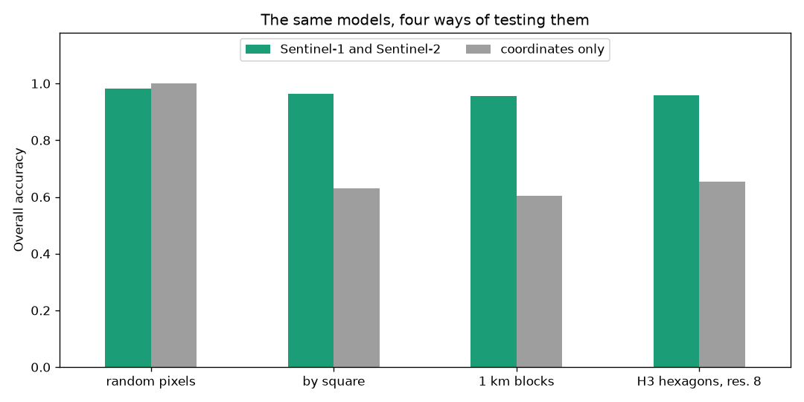
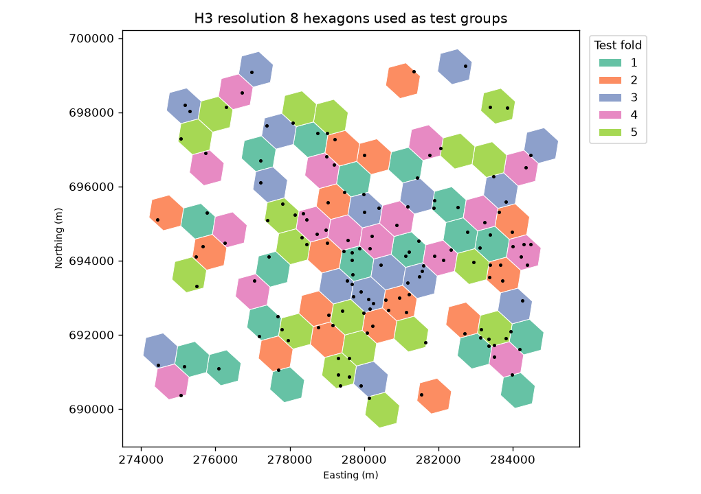

# Earth Observation and GIS Practicals

Two open practicals that teach students to map sealed and green surfaces from free satellite data and to test such
maps honestly. Both use Stirling and the Forth Valley in Scotland as the study area and rely only on open data. They
run on an ordinary laptop with no accounts at all, or in Google Colab with a Google account.

The practicals turn two of my research papers into teaching material. Lab 1 is a simplified version of the radar and
optical fusion approach in Bıçakçı (2026a). Lab 2 follows the spatially blocked validation design of Bıçakçı (2026b).

| | Lab 1 | Lab 2 |
| --- | --- | --- |
| Notebook | [Sealed and green surfaces around Stirling](notebooks/lab1_sealed_and_green_surfaces.ipynb) | [Why random splits flatter your map](notebooks/lab2_why_random_splits_flatter_your_map.ipynb) |
| Skills | STAC search, cloud masking, spectral indices, radar backscatter, random forest, confusion matrix, GeoTIFF export, zonal summary with OS Open Greenspace | Spatial autocorrelation, Moran's I, grouped cross-validation with square National Grid blocks and H3 hexagons, error mapping, optional AlphaEarth embeddings |
| Time | About two hours | About two hours |
| Level | Honours (SCQF level 10) or MSc (SCQF level 11) | Honours (SCQF level 10) or MSc (SCQF level 11) |
| Colab | [](https://colab.research.google.com/github/yunusserhat/eo-gis-practicals/blob/main/notebooks/lab1_sealed_and_green_surfaces.ipynb) | [](https://colab.research.google.com/github/yunusserhat/eo-gis-practicals/blob/main/notebooks/lab2_why_random_splits_flatter_your_map.ipynb) |



## How the labs teach

Each section follows the same five steps, adapted from the PRIMM approach to teaching programming.

1. **Predict.** Students write down what they expect before running a cell.
2. **Run.** They run the cell.
3. **Investigate.** They compare the result with their prediction and answer short questions.
4. **Modify.** They change one thing and run it again.
5. **Make.** At the end they apply the workflow to a new place, which leads into the assessment.

## Results at a glance (spoilers for students)

- In Lab 1 a random forest on eleven Sentinel-1 and Sentinel-2 features reaches 0.977 overall accuracy on a random
  30% test set. About 81% of the study area maps as green, 15% as sealed and 4% as water. Golf courses and public parks
  look almost entirely green from space, while tennis courts and sports facilities look about one third sealed.
- In Lab 2 the same model scores 0.957 when whole 1 km blocks are held out and 0.958 with H3 hexagons of similar size
  (resolution 8, 0.74 km² on average). A model that knows only the coordinates of each pixel, and nothing the
  satellite saw, scores 1.000 under a random split, 0.604 under 1 km blocks and 0.653 under H3 hexagons. Moran's I for
  NDVI at the training pixels is 0.94, which explains the gap.





## Getting started

### In Google Colab

Click the Colab badge of a lab in the table above. The first code cell installs the few packages that Colab lacks,
which takes about a minute, and the rest runs unchanged. Lab 2 can be opened on its own. When it cannot find a local
copy of the Lab 1 outputs, it downloads the saved ones from `lab1_outputs/`. For the optional AlphaEarth section, run
`os.environ["EE_PROJECT"] = "your-project"` in a new cell first. Colab then asks you to authorise Earth Engine.

### On your own computer

```bash
git clone https://github.com/yunusserhat/eo-gis-practicals.git
cd eo-gis-practicals
python -m venv .venv
source .venv/bin/activate        # on Windows use .venv\Scripts\activate
pip install -r requirements.txt
jupyter lab
```

Conda users can create the environment with `conda env create -f environment.yml` instead.

Open `notebooks/lab1_sealed_and_green_surfaces.ipynb` and run it from the top. It fills `data/` with about 250 MB and
runs in a few minutes on a laptop with a good connection. Then open Lab 2, which reuses the training pixels saved by
Lab 1.

The AlphaEarth extension at the end of Lab 2 is optional. It needs a free Google Earth Engine account and a Cloud
project. Set the environment variable `EE_PROJECT` to the project before starting Jupyter.

## Repository contents

```
notebooks/        the two executed notebooks
src_notebooks/    the same notebooks as plain Python files (jupytext percent format), easy to read and compare
teaching/         instructor notes, an assessment brief and a marking rubric
lab1_outputs/     saved Lab 1 outputs, which Lab 2 downloads when it runs on its own
figures/          figures saved by the notebooks
requirements.txt  pip environment
environment.yml   conda environment
```

## Teaching materials

- [Instructor notes](teaching/instructor_notes.md) give timings, expected results, answers to the prediction questions,
  common problems and ways to adapt the labs for Honours and MSc students.
- [Assessment brief](teaching/assessment_brief.md) sets a mapping and validation report for a Scottish town of the
  student's choice.
- [Marking rubric](teaching/marking_rubric.md) uses four criteria and the usual UK marking bands.

## Data and credits

- Copernicus Sentinel-2 Level-2A and Sentinel-1 radiometrically terrain-corrected data, accessed through the Microsoft
  Planetary Computer. Contains modified Copernicus Sentinel data (2025).
- ESA WorldCover 10 m 2021 v200 (Zanaga et al., 2022), CC BY 4.0.
- OS Open Greenspace. Contains OS data © Crown copyright and database rights 2026, used under the OS OpenData licence.
- Optional. Google Satellite Embedding dataset (AlphaEarth Foundations) in Google Earth Engine, used under its terms
  of use.

## References

- Bıçakçı, Y. S. (2026a). Impervious surface segmentation from multisource satellite imagery using early-fusion deep
  ensembles. *International Journal of Environment and Geoinformatics*. In press.
- Bıçakçı, Y. S. (2026b). AlphaEarth embeddings match conventional Earth observation for street-level greenery.
  *Photogrammetric Engineering & Remote Sensing*. In press.
- Ploton, P., et al. (2020). Spatial validation reveals poor predictive performance of large-scale ecological mapping
  models. *Nature Communications*, 11, 4540. https://doi.org/10.1038/s41467-020-18321-y
- Roberts, D. R., et al. (2017). Cross-validation strategies for data with temporal, spatial, hierarchical, or
  phylogenetic structure. *Ecography*, 40(8), 913–929. https://doi.org/10.1111/ecog.02881
- Zanaga, D., et al. (2022). *ESA WorldCover 10 m 2021 v200*. Zenodo. https://doi.org/10.5281/zenodo.7254221

## Licence

The code is released under the GNU General Public License, version 3 or any later version (see `LICENSE`). Anyone
may use, study, share and change it, and shared or changed versions must stay under the same licence. The text,
notebook narrative, figures and teaching materials are released under CC BY 4.0 (see `LICENSE-CONTENT.md`).
Downloaded data keep their own licences, listed above.

## Citation

If you use these practicals in your teaching, please cite them using `CITATION.cff`.

## Author

Yunus Serhat Bıçakçı, Department of Artificial Intelligence and Machine Learning, Marmara University, and Geospatial
Data Science Group, University of Glasgow. [ORCID 0000-0002-7288-9959](https://orcid.org/0000-0002-7288-9959)
